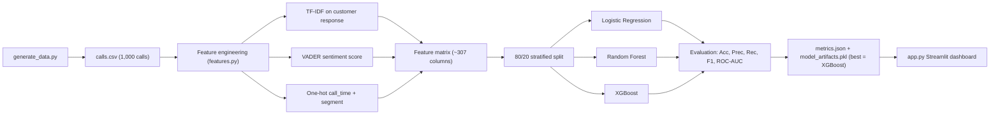

# Telecalling Conversion Predictor – Project Summary

## 1. Problem Statement
Indian telemarketing teams (credit cards, loans, insurance) make hundreds of calls a day, but only a fraction convert. This project predicts the **probability that a call will convert** from the **customer's responses in the opening of the call**, plus the call time and customer segment. Agents can then prioritise hot leads and spend less time on cold ones.

**Type of ML task:** binary classification (converted = 1 / not converted = 0) with probability output.

---

## 2. End-to-End Pipeline



| File | Role |
|---|---|
| `generate_data.py` | Builds the synthetic dataset `calls.csv` |
| `features.py` | Shared feature engineering + word-impact explainer |
| `train.py` | Trains/compares 3 models, saves metrics, artifacts and plots |
| `app.py` | Streamlit dashboard (Live Predictor + Algorithm Comparison) |
| `metrics.json` | Test-set scores of all 3 models |
| `model_artifacts.pkl` | Best pipeline, vectorizer, preprocessor, all 3 pipelines |
| `model_comparison.png`, `shap_summary.png` | Presentation charts |

---

## 3. Dataset (`calls.csv`)

> [!IMPORTANT]
> The dataset is **synthetic** (programmatically generated). It demonstrates the methodology; results do not represent real call-centre performance.

### 3.1 Columns
| Column | Type | Used by model? | Description |
|---|---|---|---|
| `transcript_opening` | text | No | Full 3-line call (Agent → Customer → Agent) |
| `agent_lines` | text | No | Caller's speech only (scripted, always upbeat) |
| `customer_response` | text | **Yes** | Client's speech only – the main signal |
| `call_time` | category | **Yes** | Morning / Afternoon / Evening |
| `customer_segment` | category | **Yes** | Salaried / Self-Employed / Student |
| `product` | category | No | credit_card, personal_loan, health_insurance, term_insurance, home_loan |
| `converted` | 0/1 | Target | Whether the call converted (≈47% positive) |

### 3.2 How each row is generated
1. **Product** is picked at random, and the **agent pitch** is filled from templates (Indian names, banks, offers).
2. **Customer intent** is sampled. Each intent has a base conversion probability:

| Intent | Share | Base P(convert) | Example customer line |
|---|---|---|---|
| Positive | 20% | 0.96 | "Haan ji, actually I was looking for this only." |
| Curious question | 22% | 0.89 | "Is there an annual fee for this card?" |
| Hesitant question | 6% | 0.25 | "I am not sure. What is the interest rate?" |
| Busy | 13% | 0.07 | "I am in a meeting right now, call me later." |
| Send on WhatsApp | 12% | 0.15 | "Just send the details on WhatsApp, I will check." |
| Price objection | 10% | 0.05 | "Your interest rate is too high, other banks are cheaper." |
| Not interested | 15% | 0.02 | "Not interested, please don't call again." |

3. **Business adjustments** are added:
   - Call time: Evening +0.07, Morning −0.03, Afternoon −0.05
   - Segment: Salaried +0.06; Self-Employed +0.05 for loans; Student −0.20 for loans/term insurance, −0.08 otherwise
4. The final probability is clipped to [0.01, 0.98], and the label is **sampled** (Bernoulli). This deliberate randomness adds label noise, so a perfect classifier is impossible (realistic ~85–90% ceiling).

---

## 4. Feature Engineering (`features.py`)

All three algorithms receive **exactly the same feature matrix**, built by a scikit-learn `ColumnTransformer`:

| Block | Source column | Method | Output |
|---|---|---|---|
| Text | `customer_response` | `TfidfVectorizer(ngram_range=(1,2), max_features=300, sublinear_tf=True)` with a custom stop-word list | up to 300 columns |
| Sentiment | `customer_response` | VADER compound score (−1 … +1), then `StandardScaler` | 1 column |
| Metadata | `call_time`, `customer_segment` | `OneHotEncoder` | 6 columns |

**Key design decisions**
- **Customer-only text.** Agent lines are scripted and always positive, so they add noise. Filler words in them (e.g. "am") picked up spurious weight, so only the client's speech is analysed.
- **Custom stop words.** Filler words (*am, is, the, I, my, sir, ji, okay…*) are removed, but **negations are kept** (*not, no, don't*) because they are the strongest objection signals. (scikit-learn's built-in English list would remove "not".)
- **Bigrams** capture phrases such as "not interested", "annual fee", "call later", "on whatsapp".
- **TF-IDF** weights a word by how often it appears in a response, discounted by how common it is across all responses, so distinctive words count more.
- **VADER** is a rule-based sentiment lexicon tuned for short, informal text, which suits spoken replies. It needs no training.

---

## 5. Algorithms

> [!NOTE]
> The project uses three **supervised classification algorithms**, not search algorithms. Each learns a mapping from the feature vector to P(converted = 1). There is no hyperparameter search (e.g. GridSearchCV); hyperparameters were fixed by hand to keep training fast on an 8 GB laptop.

### 5.1 Logistic Regression
**How it works:** a linear model that computes a weighted sum of all features and passes it through the sigmoid function:

$$P(\text{convert}) = \sigma(w_0 + w_1x_1 + \dots + w_nx_n) = \frac{1}{1+e^{-z}}$$

The weights are learned by minimising log-loss, with L2 regularisation.

**Interaction with the dataset:**
- Each TF-IDF word/bigram gets **one weight**. Words like "interested", "apply" and "sounds good" get positive weights; "not interested", "meeting" and "whatsapp" get negative weights.
- The VADER score and metadata columns each get one weight (e.g. Evening positive, Student negative).
- It cannot model interactions (e.g. "Student **and** personal loan") unless they appear as explicit features.
- It works very well with sparse, high-dimensional TF-IDF text, which is why it is close to the best model here (and has the highest ROC-AUC).

**Hyperparameters:** `C=2.0` (inverse regularisation strength), `max_iter=2000`.

### 5.2 Random Forest
**How it works:** an ensemble of many decision trees. Each tree is trained on a **bootstrap sample** of the rows and considers a random subset of features at each split. The final probability is the **average vote** of all trees (bagging).

**Interaction with the dataset:**
- Each tree splits on thresholds such as "TF-IDF('not') > 0.1?" → "VADER < −0.3?" → "call_time = Evening?", so it naturally learns **feature interactions**.
- Randomising rows and features decorrelates the trees, which lowers variance and resists overfitting the noisy labels.
- With 300 sparse text columns, many splits are on rarely-present words, so RF is slightly less efficient than LR on text. That is consistent with its marginally lower scores.

**Hyperparameters:** `n_estimators=300`, `max_depth=12`, `min_samples_leaf=2`, `n_jobs=2` (RAM-friendly).

### 5.3 XGBoost (Extreme Gradient Boosting) – **selected best model**
**How it works:** builds trees **sequentially**. Each new shallow tree is fitted to the **errors (gradients)** of the ensemble so far. Predictions are the sum of all trees' outputs, passed through a sigmoid. Built-in regularisation, row/column subsampling and the histogram split method make it fast and robust.

**Interaction with the dataset:**
- Early trees capture the dominant signals (negations, positive phrases, VADER score).
- Later trees correct harder cases, such as hesitant questions or students asking about loans, by combining text with metadata.
- `subsample=0.9` and `colsample_bytree=0.8` add randomness that guards against the label noise.

**Hyperparameters:** `n_estimators=250`, `max_depth=4`, `learning_rate=0.08`, `subsample=0.9`, `colsample_bytree=0.8`, `tree_method="hist"`, `n_jobs=2`.

### 5.4 Side-by-side
| Aspect | Logistic Regression | Random Forest | XGBoost |
|---|---|---|---|
| Model family | Linear | Bagged trees | Boosted trees |
| Learns interactions | No | Yes | Yes |
| Training | Single optimisation | Trees in parallel | Trees in sequence |
| Interpretability | High (one weight per word) | Medium | Medium (SHAP) |
| Speed on this data | Fastest | Moderate | Fast |

---

## 6. Training & Evaluation Protocol (`train.py`)
1. Load `calls.csv` and compute the VADER score for each `customer_response`.
2. **Stratified 80/20 split** (`random_state=42`): **800 train / 200 test**, keeping the ~47% conversion rate in both sets.
3. For each algorithm, build `Pipeline([preprocessor, classifier])`. The TF-IDF vocabulary is **fitted on the training set only**, so no information leaks from the test set.
4. Evaluate on the 200 held-out calls.
5. **Best model = highest F1-Score** (ROC-AUC as tie-breaker).
6. Save `metrics.json`, `model_artifacts.pkl`, `model_comparison.png` and `shap_summary.png`.

### Metrics explained
| Metric | Meaning in this project |
|---|---|
| Accuracy | % of calls classified correctly |
| Precision | Of calls predicted "will convert", how many actually did. High precision means agents don't waste time on false hot leads |
| Recall | Of calls that actually converted, how many were caught. High recall means few missed opportunities |
| F1-Score | Harmonic mean of precision and recall (used for model selection) |
| ROC-AUC | Ranking quality across all thresholds (0.5 = random, 1.0 = perfect) |

---

## 7. Results (200-call test set)

| Model | Accuracy | Precision | Recall | F1-Score | ROC-AUC |
|---|---|---|---|---|---|
| Logistic Regression | 0.880 | 0.917 | 0.819 | 0.865 | **0.936** |
| Random Forest | 0.875 | 0.897 | 0.830 | 0.862 | 0.919 |
| **XGBoost** ⭐ | **0.885** | **0.918** | **0.830** | **0.872** | 0.927 |

**Confusion matrices** (rows = actual No/Yes, columns = predicted No/Yes)

| Model | TN | FP | FN | TP |
|---|---|---|---|---|
| Logistic Regression | 99 | 7 | 17 | 77 |
| Random Forest | 97 | 9 | 16 | 78 |
| XGBoost | 99 | 7 | 16 | 78 |

**Interpretation**
- All three models perform within ~1% of each other, which shows the **features carry most of the signal**.
- XGBoost wins on F1 and accuracy. Logistic Regression has the best ROC-AUC, so it is a strong, simpler alternative.
- Precision (~0.92) is higher than recall (~0.83): the models are conservative, so a "High priority" flag is very reliable.
- Remaining errors come mostly from the deliberate label noise (e.g. a positive customer who still didn't convert).

---

## 8. Explainability
| Technique | Where | What it shows |
|---|---|---|
| **SHAP** (`TreeExplainer` / `LinearExplainer`) | `shap_summary.png`, Tab 2 | Global: which features push predictions up or down across the test set |
| **Leave-one-word-out** | Tab 1 word-impact chart | Local: for the entered conversation, each client word is removed and the response re-scored. The probability change is that word's impact (green = increases, red = decreases) |

---

## 9. Streamlit Dashboard (`app.py`)
**Tab 1 – Live Call Predictor**
- Dropdowns: Call Time, Customer Segment, sample conversation, model choice.
- **6 alternating text boxes:** Caller 1 → Client 1 → Caller 2 → Client 2 → Caller 3 → Client 3. Only the three client boxes are joined and scored.
- Output: large conversion %, a colour-coded priority badge (High ≥ 65%, Medium 35–65%, Low < 35%), the VADER score, a highlighted text view and a word-impact bar chart.

**Tab 2 – Algorithm Comparison & Metrics**
- Comparison table (best value per metric highlighted), grouped bar chart, confusion matrices, SHAP chart and methodology notes.

---

## 10. Hardware Considerations (8 GB RAM)
- Small dataset (1,000 rows); TF-IDF capped at 300 features.
- `n_jobs=2` for Random Forest and XGBoost; XGBoost uses `tree_method="hist"`.
- Full training run takes about 20–30 seconds on CPU; no GPU required.

## 11. Limitations & Future Work
- **Synthetic data:** validate on real (anonymised) call transcripts.
- Training rows contain a single customer reply, while the app accepts three. Generating multi-turn training conversations would align the two.
- Hindi/Hinglish support is limited to a few phrases. Multilingual embeddings (e.g. IndicBERT) could help.
- Add hyperparameter tuning (GridSearchCV / Optuna) and k-fold cross-validation for more robust estimates.
- Integrate speech-to-text so predictions run live during the call.

## 12. How to Run
```powershell
python -m venv venv
.\venv\Scripts\pip install -r requirements.txt
.\venv\Scripts\python generate_data.py
.\venv\Scripts\python train.py
.\venv\Scripts\streamlit run app.py
```
